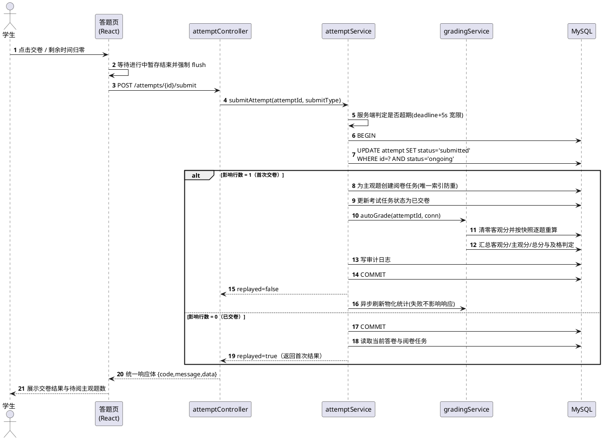

# 题目：在线考试系统的设计与实现

| 项目 | 内容 |
| --- | --- |
| 学院 | __ |
| 专业 | 软件工程 / 计算机科学与技术（__） |
| 班级 | __ |
| 学号 | __ |
| 姓名 | __ |
| 指导教师 | __ |
| 完成日期 | 2026 年 10 月 |

---

## 摘要

考试是检验学习效果、反馈教学质量的核心环节，而传统线下考试在命题、监考、阅卷与统计环节高度依赖人工，存在周期长、易出错、分析维度单一等问题；轻量课堂工具正式考试能力不足，商业平台则部署成本高、流程固化。针对院系级、课程级中小规模正式考试场景，本文设计并实现了一套覆盖题库管理、组卷、考试发布、在线答题、自动阅卷、人工复核与成绩统计全流程的在线考试系统。

系统以 React 18 + Vite 构建单页前端，Node.js 18 + Express 4 实现模块化单体后端，MySQL 8.0 持久化数据，并以需求追踪矩阵贯通 53 条功能需求、18 条非功能需求、41 个用例、31 张数据表、102 个接口与 397 个测试用例。设计上以 JWT 与 RBAC 构成功能权限与数据权限双层鉴权（401/403）；以服务端时间为唯一计时基准，客户端倒计时每 30 秒校准；以条件更新配合生成列唯一索引实现交卷与判分幂等，重复提交返回首次结果并标记 replayed；以三层快照使判分只读答卷快照，保证题库演进不影响历史成绩。

测试执行 22 个套件共 397 个用例，全部通过；语句与行覆盖率 84.80%、分支 70.62%、函数 85.83%。发现的 5 个缺陷（1 高、2 中、2 低）全部修复并回归通过；18 条非功能需求中 5 条完全达标、8 条部分达标、5 条未验证、0 条不达标。结果表明系统在轻量技术栈下实现了流程闭环、判分可靠、统计可分析与部署轻量的目标。

**关键词**：在线考试系统；React；Node.js；RBAC；幂等设计

## Abstract

Examination is a core link in the teaching process for evaluating learning outcomes and feeding back teaching quality. Traditional paper-based examinations rely heavily on manual work in item authoring, invigilation, marking and statistics, which leads to long cycles, high costs and a single dimension of score analysis; lightweight classroom tools lack the capability of formal examinations, while commercial platforms suffer from high deployment costs and rigid workflows. Targeting faculty-level and course-level formal examinations of small to medium scale, this thesis designs and implements an Online Examination System covering question bank management, paper assembly, exam publishing, online answering, automatic grading, manual review and score statistics.

The system adopts React 18 with Vite for the front end, Node.js 18 with Express 4 for a modular monolithic back end and MySQL 8.0 for persistence, and a requirements traceability matrix connects 53 functional requirements, 18 non-functional requirements, 41 use cases, 31 database tables, 102 REST endpoints and 397 test cases. Four engineering problems are addressed: JWT with RBAC builds a two-layer authorization model of functional permission and data scope (401/403); the server time is the single authoritative timing basis while the client countdown is calibrated every 30 seconds; submission and grading are idempotent through conditional updates and a generated-column unique index, with repeated submissions returning the first result flagged as replayed; and a three-layer snapshot mechanism ensures that grading reads only the attempt snapshot, so question bank evolution never affects historical scores.

A total of 397 test cases in 22 suites were executed and all passed, with statement and line coverage of 84.80%, branch coverage of 70.62% and function coverage of 85.83%. Five defects (one high, two medium and two low severity) were found, fixed and verified by regression. Among the 18 non-functional requirements, 5 are fully satisfied, 8 partially satisfied and 5 remain unverified, with none failing. The results show that the system achieves a closed workflow, reliable grading, analyzable statistics and lightweight deployment on a lean technology stack.

**Keywords**: online examination system; React; Node.js; RBAC; idempotent design

---

## 目录

- 摘要 / Abstract
- 第1章 绪论：1.1 研究背景与意义｜1.2 国内外研究现状｜1.3 研究内容与目标｜1.4 论文组织结构｜1.5 本章小结
- 第2章 相关技术：2.1 前端技术｜2.2 后端技术｜2.3 数据存储｜2.4 认证与授权｜2.5 接口契约｜2.6 测试技术｜2.7 选型对比与结论｜2.8 本章小结
- 第3章 需求分析：3.1 角色与权限｜3.2 功能需求｜3.3 非功能需求｜3.4 用例分析｜3.5 可行性分析｜3.6 本章小结
- 第4章 系统设计：4.1 总体架构｜4.2 分层与模块划分｜4.3 数据库设计｜4.4 接口设计｜4.5 核心流程设计｜4.6 关键技术设计｜4.7 系统设计与实现的偏差｜4.8 本章小结
- 第5章 系统实现：5.1 开发环境与工程结构｜5.2 后端关键实现｜5.3 前端关键实现｜5.4 难点与解决方案｜5.5 系统界面说明｜5.6 本章小结
- 第6章 系统测试：6.1 环境与策略｜6.2 用例设计｜6.3 执行结果｜6.4 覆盖率分析｜6.5 缺陷闭环｜6.6 非功能需求验证｜6.7 测试结论与局限｜6.8 本章小结
- 第7章 总结与展望：7.1 工作总结｜7.2 不足与改进方向｜7.3 展望｜7.4 本章小结
- 参考文献
- 致谢

---

## 第1章 绪论

### 1.1 研究背景与意义

考试是教学活动闭环中不可替代的测量环节：它既检验学习结果，也为教师调整教学策略提供依据。然而传统线下考试的组织链条冗长——命题与排版、印卷与保密运输、现场监考、逐份批改并登分、汇总报表，每一环节都由人工承担，其后果是周期长、成本高、差错率随规模上升，且成绩数据在登分之后往往停留在"一张表"的水平，难以支撑题目质量分析与知识点薄弱诊断。

教育信息化政策为这一问题提供了制度基础，《教育信息化2.0行动计划》明确要求推进信息技术与教育教学深度融合、推动教学与管理流程数字化转型<sup>[1]</sup>；网络与终端普及则提供了运行条件，我国网民规模与在线教育应用使用率长期保持高位<sup>[2]</sup>。在高校层面，课程门数多、单场考试规模中等、考务流程相对固定，使"轻量、可私有化、恰好够用"的在线考试系统具有明确的应用空间。

本课题的意义有四层。**教学价值**：把教师从重复性命题检索、客观题批改与登分汇总中释放出来，使考试结果转化为可直接使用的教学诊断数据。**技术价值**：在轻量技术栈下集中实践 JWT 与 RBAC 双层权限、服务端权威计时、幂等写操作、三层快照、软删除与引用保护等方法，而考试场景对其正确性要求极高，因而构成一组有代表性的验证样本。**工程价值**：以需求追踪矩阵贯通需求、用例、设计、接口、实现与测试，全部产出可追溯到具体编号，交付物组织遵循《计算机软件文档编制规范》的框架<sup>[3]</sup>。**管理价值**：审计日志、成绩发布控制与复核申诉使成绩具备可解释性与可追溯性。

### 1.2 国内外研究现状

本文选取 6 个代表性平台对比分析，结果如表 1-1。Moodle、Canvas LMS 与 Blackboard Learn 是国际主流学习管理系统，超星学习通、雨课堂与考试星分别代表国内平台化、课堂互动与 SaaS 化三种形态。

**表 1-1 典型在线考试/学习平台对比**

| 系统 | 类型与考试能力 | 主要优点 | 主要不足 |
| --- | --- | --- | --- |
| Moodle（Quiz） | 开源 LMS；题型插件、题库、随机抽题、自动判分 | 可私有化部署；题型扩展机制成熟 | 界面陈旧；运维门槛高；中文统计与可视化弱 |
| Canvas LMS | 开源/商业 LMS；题库、自动判分、成果对齐 | 界面现代；REST API 规范 | 高级题型与防作弊有限；正式考试流程不完整 |
| Blackboard Learn | 商业 LMS；测评中心、题库、远程监考 | 测评与监考生态成熟；权限体系完善 | 授权费用高；本地化与定制困难；轻量场景过重 |
| 超星学习通 | 国内商业平台；组卷、考试、监考、阅卷、成绩分析 | 移动端体验好；流程完整 | 闭源；业务与数据绑定平台；二次开发受限 |
| 雨课堂 | 课堂互动；随堂测验、限时答题、数据反馈 | 入口门槛低；即时反馈优秀 | 正式考试能力弱；主观题阅卷与归档不足 |
| 考试星 | SaaS；组卷、监考、判分、报表 | 开箱即用；防作弊较完善 | 按场次计费；数据在第三方；规则难定制 |

Moodle 的插件机制证明"校验器 + 判分器"的扩展设计可行<sup>[4]</sup>，Canvas 的开放接口体现以资源为中心、以契约为约束的规范化思路<sup>[5]</sup>，Blackboard 的监考生态说明正式考试对监考与权限体系的强依赖<sup>[6]</sup>；国内平台中，超星覆盖了从题库到成绩分析的完整链路<sup>[7]</sup>，雨课堂以低门槛入口解决课堂即时反馈<sup>[8]</sup>，考试星以 SaaS 提供开箱即用的考试与监考能力<sup>[9]</sup>。三者在权限模型上的共同选择是基于角色的访问控制，其理论基础由 Sandhu 等人系统阐述<sup>[10]</sup>。

据此可归纳出现有方案的六项共性不足，它们构成本系统的切入点：**流程闭环不完整**（主观题阅卷、双评仲裁、复核申诉与成绩发布之间存在断点，成绩出错缺少带留痕的纠正路径）；**组卷智能化不足**（多停留在按题型随机，缺少难度分布与缺口提示）；**判分可靠性缺乏工程保障**（缺少幂等设计、服务端计时与答案脱敏）；**成绩分析维度浅**（多为平均分与排名）；**防作弊依赖外部服务**（切屏与多端登录等基础留痕缺失）；**数据主权与部署成本矛盾**（SaaS 数据不在校内，开源平台运维复杂）。本文不追求大而全，而是聚焦课程级正式考试，以轻量栈实现完整闭环补齐上述短板。

### 1.3 研究内容与目标

研究内容包括五个方面：**需求工程**，以国家标准规定的文档结构为框架<sup>[3]</sup>，结合 EARS 模板建立 53 条功能需求与 18 条非功能需求基线，并编制需求追踪矩阵实现双向追溯；**系统设计**，完成技术选型、分层架构、模块划分、31 张表的数据库设计、102 个端点的接口设计与六条核心流程设计；**系统实现**，解决交卷幂等、判分可重放与断线恢复；**系统测试**，建立三层自动化测试、量化覆盖率并闭环缺陷；**工程复盘**，如实记录契约与实现的偏差<sup>[11]</sup>。

建设目标设定为 6 条可验收要求：G1 全流程闭环（8 个环节均可运行且需求编号可追溯）；G2 考试过程公平可靠（服务端计时、答案脱敏、幂等交卷、防作弊留痕）；G3 提升阅卷效率（客观题自动判分、主观题在线评分、进度监控与仲裁）；G4 提供教学决策数据（单场统计、题目质量、知识点失分、趋势对比）；G5 满足安全合规（JWT + RBAC、密码不可逆存储、敏感操作审计）；G6 形成规范可追溯交付（追踪矩阵覆盖率 100%）。

### 1.4 论文组织结构

第 1 章阐述背景、现状与目标；第 2 章介绍关键技术与选型依据；第 3 章给出角色权限、需求、用例模型与可行性论证；第 4 章给出架构、模块、数据库、接口、核心流程与关键技术设计，并记录偏差；第 5 章说明关键实现、四个难点与界面；第 6 章给出测试设计、执行结果、覆盖率、缺陷闭环与 NFR 验证；第 7 章总结并展望。

### 1.5 本章小结

本章界定研究范围，通过 6 个平台的对比归纳出六项共性不足，并确定研究内容与 6 条建设目标。

---

## 第2章 相关技术

### 2.1 前端技术

React 是组件化的声明式 UI 库，核心机制包括虚拟 DOM 差异比对、单向数据流与 Hooks 状态管理，React 18 的并发渲染进一步改善了复杂页面的交互响应<sup>[12]</sup>。本系统中 React 承担三项职责：以组件复用降低开发成本（表格、分页、弹窗等基础组件被 26 个页面共享）；以 Hooks 把答题页的倒计时与暂存队列收敛在局部作用域，避免全局重渲染；通过路由级代码分割减小首屏体积。选择依据是：组件模型与"同一数据以列表、详情、编辑三态呈现"的页面特征契合；生态成熟，配套方案可按需引入；与 Node.js 共享语言特性，便于单人贯通两端<sup>[13]</sup>。

Vite 以原生 ES 模块提供开发期按需编译、以 Rollup 完成生产构建，冷启动快且可按路由自动分包，使登录页与三角色工作台各成独立 chunk<sup>[14]</sup>；考试系统无需搜索引擎优化，服务端渲染的部署复杂度并无收益，故采用纯客户端渲染。路由由 React Router 6 提供嵌套路由与守卫，鉴权状态用轻量状态库管理，HTTP 请求用 Axios 拦截器统一注入令牌、解包响应体并处理 401 刷新，统计图表以原生 SVG 自绘以避免引入完整图表库。

### 2.2 后端技术

Node.js 基于 V8 与事件循环，采用单线程非阻塞 I/O，契合本系统"短请求、高并发、数据库访问密集"的特征：单次请求以若干次数据库往返为主，CPU 密集度低，事件循环可将大量并发请求的等待时间重叠<sup>[15]</sup>。其模块机制使五层结构（路由、控制器、服务、模型、中间件）可用简单依赖表达，无需依赖注入容器<sup>[16]</sup>。Express 的核心是中间件洋葱模型，本系统据此编排横切关注点：安全头、跨域、解析、请求上下文、限流、认证、鉴权、校验、业务处理、审计与异常处理，顺序在装配处一次性固定<sup>[17]</sup>。

Express 不提供 ORM 与强约束分层，在本项目中是有意选择：需求要求全部参数化 SQL，以便对索引、事务与锁行为保持完全控制，分层由目录约定与代码评审保证，依据是"依赖方向单一、跨层调用禁止"的经典原则<sup>[18]</sup>。数据访问用 mysql2 连接池，安全以 helmet、cors 与限流中间件落实，参数校验用 zod 声明模式并与契约字段约束对齐。

### 2.3 数据存储

MySQL 8.0 是本系统唯一持久化存储，关键能力包括事务与行级锁（保证跨表写的原子性）、JSON 数据类型（存储选项与快照）、生成列与唯一索引（以数据库约束保证"同一考生同一考试最多一条进行中答卷"）以及窗口函数与聚合函数<sup>[19]</sup>。选择关系模型的理由是考试核心数据存在强一致约束（如"答卷总分必须等于各题得分之和"），用外键、唯一索引与事务表达最自然，而半结构化数据又可通过 JSON 列获得灵活性<sup>[20]</sup>。系统未引入 ORM：查询模式对执行计划敏感，列表查询依赖复合索引列顺序、超时扫描依赖截止时间索引，手写 SQL 配合执行计划检查才能保证性能可预期<sup>[21]</sup>。

### 2.4 认证与授权

JWT 是以 JSON 承载声明的紧凑令牌格式，签名保证内容不被篡改<sup>[22]</sup>。系统采用 HS256，访问令牌有效期 2 小时，载荷仅含用户标识、角色、令牌版本号与唯一标识，不携带权限点全量列表。无状态令牌的固有问题是"签发后难以撤回"，系统以两项机制弥补：刷新令牌白名单表（库中仅存摘要，刷新时轮换并使旧令牌失效）与用户表令牌版本号（改密、禁用、角色变更时自增，中间件每次比对）。

RBAC 把"用户—权限"的多对多关系降解为两次一对多关系，显著降低授权管理复杂度<sup>[10]</sup>。系统在其上补充数据权限维度，形成"功能权限 + 数据权限"双层模型。安全实现参照 OWASP Top 10，重点应对失效的访问控制、加密机制失效与注入<sup>[23]</sup>，措施包括 bcrypt 加盐哈希（代价因子不低于 10）、全参数化查询、输出转义、登录失败锁定与接口限流。

### 2.5 接口契约

REST 强调以资源为中心、以统一接口约束交互<sup>[24]</sup>。系统按业务域划分资源、以 HTTP 方法表达语义，对无法映射为增删改查的动作使用动词子路径，并在前缀中固化版本号 `/api/v1`。接口以 OpenAPI 3.0.3 描述路径、参数与安全要求<sup>[25]</sup>，共 83 个路径、102 个 operationId。契约先行的收益有三：编码前对齐字段与错误码；作为测试比对基准，通过运行时反射后端路由与契约集合求差发现漂移；天然记录角色约束。

### 2.6 测试技术

Jest 提供断言、Mock 与覆盖率统计，并支持以 `jest.mock` 替换模块依赖<sup>[26]</sup>，用于覆盖判分引擎、校验器、令牌与密码工具及业务服务分支；覆盖率采用 V8 原生统计以避免插桩损耗。Supertest 可直接驱动 Express 实例而无需监听端口，集成测试在真实 MySQL 测试库上执行，数据全部经真实接口创建。测试质量度量参照系统与软件质量要求标准，以功能正确性、性能效率、安全性与可维护性划分覆盖<sup>[27]</sup>。

### 2.7 选型对比与结论

五类关键决策的对比见表 2-1。

**表 2-1 技术选型对比**

| 决策项 | 备选方案 | 最终选择与理由 |
| --- | --- | --- |
| 前端框架 | Vue 3、Next.js、原生 Canvas | **React 18 + Vite**：组件化彻底、构建快、可路由分包；考试系统无需 SSR |
| 后端框架 | NestJS、Koa 2、Spring Boot | **Express 4 + 分层自治**：极轻量、易实现 RBAC 与审计；NestJS 对毕设规模属过度设计 |
| 数据库 | PostgreSQL、MongoDB、SQLite | **MySQL 8 单实例单库**：JSON 存快照、生成列与 CHECK 保证约束；SQLite 并发写弱 |
| 鉴权方案 | Session + Cookie、OAuth2/CAS | **JWT + RBAC + 令牌版本号**：无状态、可实现即时失效 |
| 异步处理 | Redis + BullMQ、数据库轮询 | **进程内任务 + 定时轮询**：零中间件、配合幂等可重放 |

选型结论为：前端 React 18 + Vite + React Router 6，后端 Node.js 18 + Express 4，数据库 MySQL 8.0，鉴权 JWT + RBAC，异步处理采用进程内定时任务。该组合的特征是"零额外中间件"，仅依赖 Node.js、MySQL 与 Nginx 即可运行。这不是能力妥协，而是与规模假设匹配：单场 500 人、总用户 5000 人、答卷 100 万行，判分为纯 CPU 计算（单份不超过 100 毫秒），超时容忍度为分钟级。演进边界也由此划定：当单机无法承载时，可沿"判分队列化、缓存外置、限流分布式化"推进，且不改变现有契约。

### 2.8 本章小结

本章介绍九项关键技术的职责与选型依据，并以一张表汇总五类决策；技术主线是"全栈 JavaScript + 关系型数据库 + 零额外中间件"。

---

## 第3章 需求分析

本章把"用户需要什么"转化为"系统必须做到什么"。需求表述采用 EARS 模板，即以"当〈触发条件〉时，系统应当〈响应〉"约束每条需求，使其天然携带触发条件与可观测响应，可直接转化为测试用例<sup>[28]</sup>。

### 3.1 角色与权限

系统面向高校课程考试，只设三类角色，不做更细的岗位划分，如表 3-1。

**表 3-1 角色定义与权限范围**

| 角色 | 代码 | 权限范围 | 典型场景 |
| --- | --- | --- | --- |
| 管理员 | `admin` | 账号与角色管理、参数配置、全局题库与试卷监管、审计日志、数据备份、成绩争议仲裁 | 学期初建号分班；修正答案后批量重判 |
| 教师 | `teacher` | 本人或被授权题库、组卷、创建与发布考试、监考数据查看、主观题阅卷、成绩统计与发布、复核处理 | 按章节维护题库；按难度比例随机组卷；批改主观题 |
| 学生 | `student` | 注册申请、查看可参加考试、在线答题、查询本人成绩、发起成绩复核 | 参加考试；查看逐题得分与评语；申请复核 |

三个角色的关键差异有四方面，直接决定了后续架构。**功能权限与数据权限分离**：前者判定"能否调用该接口"，后者判定"能否访问这一条数据"（教师只能操作本人题库与考试，学生只能访问本人答卷）。**受限允许必须叠加状态条件**：管理员可查看但不可代替教师组卷；试卷被考试引用即锁定；答卷交卷后禁止写入；成绩未发布前学生只能看到"评阅中"。**时间与次数构成硬约束**：考试窗口外禁止开考与暂存；作答次数用尽后须经补考授权。**服务端是唯一安全边界**：前端隐藏菜单不构成权限保证。

### 3.2 功能需求

功能需求按业务域分 7 个模块，编号为 `REQ-<模块缩写>-<两位序号>`，优先级分三级：高表示核心闭环或安全底线，中表示显著提升效率，低表示可降级的增强功能。分布如表 3-2，合计 53 条（高 30、中 20、低 3）。

**表 3-2 功能需求模块分布（53 条）**

| 模块 | 编号范围 | 条数 | 高/中/低 | 主要功能 |
| --- | --- | :---: | :---: | --- |
| 用户与权限 UAM | REQ-UAM-01~09 | 9 | 6/3/0 | 登录、锁定、令牌轮换、账号管理、注册审批、改密、权限分配、启禁用 |
| 题库 QBM | REQ-QBM-01~07 | 7 | 4/3/0 | 题目增改、版本留痕、删除保护、检索、批量导入导出、知识点维护 |
| 试卷与组卷 PPM | REQ-PPM-01~07 | 7 | 4/3/0 | 手动与随机组卷、分值校验、预览、复制、锁定归档、检索 |
| 考试与答题 EXM | REQ-EXM-01~10 | 10 | 9/1/0 | 创建与发布、资格校验、开考下发、暂存、计时、交卷、断线恢复、防作弊、变更与补考 |
| 阅卷与复核 MRK | REQ-MRK-01~07 | 7 | 3/4/0 | 自动判分、阅卷队列、人工评分、双评仲裁、复核申诉、进度监控、答案重判 |
| 成绩统计 STA | REQ-STA-01~07 | 7 | 3/3/1 | 个人成绩、单场统计、题目质量、趋势对比、发布控制、导出、图表渲染 |
| 系统管理 SYS | REQ-SYS-01~06 | 6 | 1/3/2 | 参数配置、审计日志、审计检索导出、公告、备份恢复、健康检查 |

高优先级需求集中在 EXM 与 UAM，反映"身份可信 + 考试可靠"是关键路径。以下选取 5 条对架构影响最大的需求说明其如何约束设计。

（1）**REQ-UAM-03 令牌刷新与轮换**：当客户端携带有效期内的刷新令牌请求刷新时，系统应当校验签名、白名单状态与用户状态，签发新访问令牌并同时轮换刷新令牌，使旧令牌立即失效。若刷新令牌可反复使用，一旦泄露攻击者可在 7 天内持续换取新令牌；轮换使每个令牌仅能用一次。该需求还隐含前端必须具备"401 拦截—串行刷新—重放一次"的能力。

（2）**REQ-QBM-03 题目删除保护**：当用户删除题目时，系统应当执行软删除；若该题目已被未归档试卷或进行中考试引用，应当拒绝删除并返回引用清单。返回清单而非简单提示，是因为仅告知"已被引用"会让教师无从判断先处理哪份试卷。

（3）**REQ-PPM-02 随机组卷**：当教师设定题型数量、难度分布与知识点范围并触发随机组卷时，系统应当无重复抽题生成草稿；可用题目不足时应当给出各维度缺口提示且不生成残缺试卷。该需求排除了"凑数生成"，因为残缺试卷的代价远高于一次明确的失败提示。

（4）**REQ-EXM-06 服务端权威计时**：当学生处于考试中时，系统应当以服务端时间为基准下发剩余秒数并每 30 秒校准，客户端倒计时仅用于展示、不作为交卷判定依据。该需求把"防作弊"的边界从"检测客户端篡改"转为"根本不信任客户端"。

（5）**REQ-EXM-07 交卷（幂等）**：当学生点击交卷或剩余时间归零时，系统应当执行幂等交卷——固化答卷快照、禁止继续作答、写入交卷状态并触发判分，重复请求返回同一结果。该需求直接推导出三项约束：交卷由数据库状态机判定而非客户端声明、状态迁移必须原子化、重复请求结果一致。

需求之间还存在依赖与冲突。**依赖**：发布考试依赖试卷锁定，自动判分依赖开考快照，成绩发布依赖阅卷队列。**冲突**：题库修改需求与考试内容稳定需求在"考试进行中修改题目"时冲突，本文以快照机制解决，这也成为第 4 章"三层快照"的需求来源。

### 3.3 非功能需求

18 条非功能需求如表 3-3。

**表 3-3 非功能需求（18 条）**

| 编号 | 类别 | 指标摘要 | 优先级 |
| --- | --- | --- | :---: |
| NFR-01 | 性能 | 200 并发提交，P95 ≤ 2s、P99 ≤ 4s、错误率 ≤ 0.1% | 高 |
| NFR-02 | 性能 | 局域网首屏 LCP ≤ 2.5s，路由切换 1s 内出内容 | 中 |
| NFR-03 | 性能 | 1000 份答卷判分 ≤ 10s，单份 ≤ 100ms | 高 |
| NFR-04 | 性能 | 10 万答卷规模统计查询 ≤ 3s | 中 |
| NFR-05 | 性能 | 分页列表 P95 ≤ 500ms | 中 |
| NFR-06 | 安全性 | bcrypt 哈希且代价因子 ≥ 10，无明文密码 | 高 |
| NFR-07 | 安全性 | 全接口 JWT + RBAC，401/403 语义分离，越权用例覆盖全资源 | 高 |
| NFR-08 | 安全性 | 考试中不下发答案与解析，防作弊留痕，答卷不可跨账号访问 | 高 |
| NFR-09 | 安全性 | 审计日志在线保留 ≥ 180 天，普通角色不可读写 | 高 |
| NFR-10 | 安全性 | 强制 HTTPS、参数化查询、入参校验、XSS 与 CSRF 防护 | 高 |
| NFR-11 | 可靠性 | 30s 自动暂存，刷新/断网/重启后恢复率 100%，不重复计时 | 高 |
| NFR-12 | 可靠性 | 考试窗口可用性 ≥ 99.9%，单点故障 5 分钟内恢复 | 高 |
| NFR-13 | 可靠性 | 重复交卷结果一致、不重复判分、判分可重放 | 高 |
| NFR-14 | 可用性 | 新用户 30 分钟完成全流程，核心路径 ≤ 3 次点击 | 中 |
| NFR-15 | 可维护性 | 分层结构，Service 单测 ≥ 80%、整体 ≥ 70%，结构化日志 | 中 |
| NFR-16 | 可扩展性 | 新增题型仅改校验器与判分器且 ≤ 2 人日，接口版本化 | 中 |
| NFR-17 | 兼容性 | 主流浏览器最近 2 个大版本与 Safari 15+，最小 1280×720 | 中 |
| NFR-18 | 数据一致性 | 总分等于各题得分之和，已交卷记录唯一，成绩变更留痕 | 高 |

其中 NFR-06、07、08、11、13、18 为不可裁剪项：密码泄露、越权访问、答案泄露、答案丢失、重复判分、总分不自洽中的任何一项发生，都会使系统失去使用价值。NFR-16 则把"可扩展"从形容词变成结构要求——题型判断必须收敛到校验器与判分器两个扩展点；NFR-18 要求成绩不能由多处代码分别计算，必须由单一入口统一重算。

### 3.4 用例分析

系统共识别 41 个用例（UC-01~UC-41），按业务域分为身份与权限（01~07）、题库（08~11）、试卷与组卷（12~16）、考试与答题（17~25）、阅卷与复核（26~30）、成绩统计（31~36）、系统管理（37~41），如图 3-1，PlantUML 源码见 `docs/requirements/用例图.puml`。

**图 3-1 在线考试系统用例图（源码见 docs/requirements/用例图.puml）**

参与者维度上，管理员关联 28 个用例、教师 23 个、学生 8 个（UC-01、03、06、07、21、30、31、35）。学生关联最少，但其 UC-21（在线答题）是复杂度最高的用例。

用例间共 13 条 include 与 extend 关系：include 表示基础用例必然执行被包含用例，extend 表示特定条件下才插入。典型关系有六条——创建考试 include 试卷检索；在线答题 include 资格校验、交卷与自动判分；断线重连与防作弊采集 extend 在线答题；双评仲裁 extend 人工阅卷；复核申诉 extend 个人成绩查询；统计与趋势分析 include 图表展示。UC-21 是关系的汇聚点，include 三个用例、被两个 extend，反映了考试过程的本质：答题主线确定，断线与作弊是偶发但必须处理的旁支。

### 3.5 可行性分析

**技术可行性**：所选技术均为长期稳定的主流方案，关键风险不在"能否实现"而在"实现是否正确"；全栈 JavaScript 使单人可贯通开发与联调；四个技术难点均有成熟范式。系统不引入微服务与消息队列，降低了部署复杂度，但容量受单机限制——按设计假设（单场 500 人、总用户 5000 人、答卷 100 万行），单机 MySQL 与单实例 Node 的组合与规模自洽。

**经济可行性**：技术全部开源免费，系统可部署在一台普通服务器上，无需负载均衡、缓存集群与专用存储；功能范围经裁剪后聚焦课程级闭环，未纳入人脸识别、视频监考与多租户等高价能力。与 SaaS 相比自建前期投入略高，但长期成本更低，且成绩数据留存校内，规避了数据托管的合规风险。

**操作可行性**：登录后按角色直接进入工作台，避免功能堆叠造成认知负担；学生参加考试的完整路径为"登录—我的考试—开考"，共 3 次点击；错误码统一映射为"原因 + 下一步建议"。系统要求主流浏览器最近 2 个大版本、最小 1280×720，移动端仅支持成绩查询等只读场景。

### 3.6 本章小结

本章给出三角色的权限范围与四类关键差异；以模块汇总表加 5 条 EARS 分析刻画 53 条功能需求，并识别需求间的依赖与冲突（冲突的解决方式直接催生了三层快照）；给出 18 条非功能需求与六条不可裁剪底线；通过 41 个用例与 13 条关系刻画行为边界；从技术、经济、操作三方面论证可行性。

---

## 第4章 系统设计

### 4.1 总体架构

系统采用"单体分层 + 前后端分离"，物理上分客户端层、接入层、应用层与数据层，如图 4-1（PlantUML 源码见 `docs/design/架构图.puml`，含分层架构图与部署图）。

**图 4-1 系统总体分层架构（源码见 docs/design/架构图.puml）**

客户端运行 React 单页应用，按角色渲染三套工作台与一个全屏答题页，只负责视图与交互；接入层由 Nginx 终止 HTTPS、托管前端产物并将 `/api/` 反向代理至 Node 服务，同域部署以规避跨域风险；应用层内部再分五层；数据层为 MySQL 单实例单库，31 张表按表名前缀分域，前缀既是分类也是未来拆库的边界。

选择单体而非微服务，是因为模块间存在高频调用与事务耦合（交卷触发判分、判分完成刷新统计），拆分后需引入分布式事务或补偿；单体下"一次事务提交完成交卷、明细、阅卷任务与成绩"天然可行，且零额外中间件使部署只需 Node 与 MySQL。微服务的独立部署与伸缩收益在本系统规模下无法抵消其成本<sup>[29]</sup>。

### 4.2 分层与模块划分

系统按业务域划分 7 个模块，与需求编号、设计文档章节、论文小节严格对应，表 4-1 是需求追踪矩阵"后续设计章节"列在论文中的落点。

**表 4-1 模块划分与承接关系**

| 序号 | 模块 | 对应需求 | 设计文档章节 | 论文小节 | 表数 |
| --- | --- | --- | --- | --- | :---: |
| 1 | 用户与权限 | REQ-UAM-01~09 | §3.2 | §4.2、§4.6.1 | 6 |
| 2 | 题库管理 | REQ-QBM-01~07 | §3.3 | §4.2、§4.6.3 | 5 |
| 3 | 试卷与组卷 | REQ-PPM-01~07 | §3.4 | §4.2、§4.5.1 | 2 |
| 4 | 考试与在线答题 | REQ-EXM-01~10 | §3.5 | §4.2、§4.5.1~§4.5.3、§4.6.2 | 7 |
| 5 | 阅卷与复核 | REQ-MRK-01~07 | §3.6 | §4.2、§4.5.3 | 3 |
| 6 | 成绩统计 | REQ-STA-01~07 | §3.7 | §4.2、§4.5.3 | 3 |
| 7 | 系统管理 | REQ-SYS-01~06 | §3.8 | §4.2、§4.6.4 | 5 |

模块依赖遵循单向原则：允许"试卷调用题库校验题目可用性""考试调用试卷校验锁定状态""答题调用阅卷触发判分""阅卷调用统计刷新物化表"；禁止反向依赖与跨模块直接调用模型层，统计模块只读不改写，从结构上避免循环依赖。

各模块要点：**用户与权限**以认证与授权分离、功能与数据权限分离支撑身份可信；**题库**以校验器策略化与版本留痕支撑可维护；**组卷**坚持"不足即不生成"；**考试与答题**确立服务端计时、题目脱敏、交卷幂等、保存容错四条规则，并以三层建模解耦范围与次数；**阅卷**以"一题一任务"与变更留痕支撑可追溯；**统计**以"口径明确 + 物化加速"支撑性能；**系统管理**以参数校验与只增不改的审计支撑可运维。

应用层分五层：路由只做绑定，控制层取参与响应，服务层承载规则、事务与数据权限过滤，模型层只写 SQL，中间件处理认证、鉴权、校验、审计与异常。中间件顺序固定——若鉴权置于校验之后，非法参数会先于权限判定返回并泄露字段结构。

### 4.3 数据库设计

设计遵循六条原则：单实例单库、不分库分表（按 100 万答卷、500 万明细的量级单表可支撑）；表名前缀划分业务域；时间以 UTC 存于毫秒精度列；主键为自增整数，对外资源另给 UUID 业务号防遍历；分数用 DECIMAL 避免累加误差；JSON 仅用于快照、选项与统计分布。31 张表按域汇总如表 4-2，其中系统域与考试域合计 18 张、占 58%：前者因身份、令牌、参数、审计、通知、备份各需独立结构，后者因考试、范围、任务、答卷、授权、明细、事件七个概念必须分开建模。

**表 4-2 数据表按域汇总（31 张）**

| 域 | 表数 | 表名 |
| --- | :---: | --- |
| 系统域 `sys_` | 11 | `sys_class`、`sys_user`、`sys_role`、`sys_permission`、`sys_role_permission`、`sys_refresh_token`、`sys_config`、`sys_audit_log`、`sys_notice`、`sys_notification`、`sys_backup_record` |
| 题库域 `qb_`/`kb_` | 5 | `kb_knowledge_point`、`qb_question_bank`、`qb_bank_authorization`、`qb_question`、`qb_question_version` |
| 试卷域 `pp_` | 2 | `pp_paper`、`pp_paper_question` |
| 考试域 `ex_` | 7 | `ex_exam`、`ex_exam_scope`、`ex_exam_task`、`ex_exam_attempt`、`ex_exam_attempt_grant`、`ex_attempt_question`、`ex_anti_cheat_event` |
| 阅卷域 `mk_` | 3 | `mk_grading_task`、`mk_grade_change_log`、`mk_score_appeal` |
| 统计域 `st_` | 3 | `st_exam_stat`、`st_question_stat`、`st_knowledge_stat` |

唯一索引承担多项业务约束，典型如生成列唯一索引 `uk_attempt_active(exam_id, student_id, active_flag)`：`active_flag` 在进行中时取 1、否则取 NULL，利用唯一索引对 NULL 的宽容性，在数据库层保证"同一考生同一考试最多一条进行中答卷，而历史答卷可有任意多条"。

31 个实体间共 43 条关系线，外键强关系以一对多与一对零或一表示，逻辑关联以虚线表示，核心关系如图 4-2（源码见 `docs/design/ER图.puml`）。

**图 4-2 核心业务数据实体关系（源码见 docs/design/ER图.puml）**

核心链路为：班级→用户→题库→题目→版本；题目与试卷经明细构成多对多；试卷→考试→任务→答卷→答题明细→阅卷任务；答卷→成绩变更与复核申诉。两处设计值得说明：**考试与答卷之间隔一层任务**，否则补考授权无处记录次数上限，也无法区分"名单内未作答"与"名单外用户"；**答题明细同时承载快照、答案与得分**，使判分一次查询即获全部判定信息。核心字段如表 4-3。

**表 4-3 核心表关键字段**

| 表 | 字段 | 设计说明 |
| --- | --- | --- |
| `ex_exam_attempt` | `attempt_no` / `attempt_seq` | UUID 业务号防遍历；作答序号与唯一索引联合防重复 |
| `ex_exam_attempt` | `status` | 状态机：进行中、已交卷、判分中、已判分、已复核、已过期 |
| `ex_exam_attempt` | `started_at` / `deadline_at` | 服务端开考与截止时间，写入后不变更 |
| `ex_exam_attempt` | `objective_score` / `subjective_score` / `total_score` | DECIMAL 分项与总分，总分为两项之和 |
| `ex_exam_attempt` | `active_flag` | 生成列，进行中取 1 否则 NULL，配合唯一索引 |
| `ex_attempt_question` | `question_snapshot` / `student_answer` | 题目完整快照（仅服务端使用）与考生答案 |
| `ex_attempt_question` | `answer_version` | 乐观锁版本，解决多标签页并发覆盖 |
| `ex_attempt_question` | `auto_score` / `manual_score` / `final_score` | 自动分、人工分、最终分，最终分为唯一汇总依据 |

### 4.4 接口设计

接口统一前缀 `/api/v1`，资源用复数名词与短横线，层级最多两级。状态码处理通用分支（401 重新登录、403 跳转禁止页、409 冲突、422 字段错误），5 位业务码处理具体分支。统一响应体为 `{code, message, data}`，校验失败附加 `errors`；系统禁止"HTTP 200 + 业务码非 0"的伪成功写法，因为伪成功会让网关、监控与日志误判成功率。业务码首位标识模块；分页响应为 `{list, total, page, pageSize}`，默认每页 20 条、上限 100 条，排序字段走白名单。102 个端点按域分布如表 4-4。


102 个端点按域分布如表 4-4。

**表 4-4 接口端点分布（102 个）**

| 业务域 | 端点数 | 代表性端点 |
| --- | :---: | --- |
| 认证与账号 | 7 | `login`、`refreshToken` |
| 用户与权限 | 14 | `createUser`、`updateUserRole` |
| 知识点 | 4 | `listKnowledgePoints` |
| 题库与题目 | 15 | `createQuestion`、`rejudgeQuestion` |
| 试卷与组卷 | 12 | `createPaper`、`randomAssemblePaper` |
| 考试管理 | 11 | `createExam`、`publishExam` |
| 在线答题 | 8 | `startAttempt`、`submitAttempt` |
| 阅卷与复核 | 5 | `scoreGradingTask`、`arbitrateGradingTask` |
| 成绩与统计 | 13 | `publishScores`、`getExamStatistics` |
| 系统管理 | 13 | `listConfigs`、`getHealth` |

端点规模与模块复杂度大体吻合，但接口数量不等于复杂度——真正决定复杂度的是单接口的状态判定与并发处理。

### 4.5 核心流程设计

#### 4.5.1 组卷、开考与暂存

**组卷**：系统校验题目不重复、属于本人或被授权题库、分值之和等于总分；随机组卷按题库、题型、难度与知识点构造候选池，取目标数量的 3 倍按难度配额二次抽取——若直接全表随机，难度分布必然偏离设定；任一维度不足时汇总缺口且不写库。试卷被考试引用即自动锁定，此后只允许改名称与说明。

**开考**：同一事务内校验考试状态与时间窗、是否存在考试任务、是否已有进行中答卷（有则返回该答卷并标记重放，实现断线重连）、作答次数未用尽；通过后创建答卷（截止时间取时长与窗口结束时间的较早者）并复制题目快照。题序打乱以"答卷业务号 + 题目 ID"的哈希作种子，保证多次请求顺序稳定。**暂存**校验归属、状态、服务端时间、题目归属与答案版本后逐题条件更新，影响行数为 0 说明版本被并发修改；暂存不修改截止时间，否则学生可通过频繁暂存"续时"。

#### 4.5.2 交卷与判分

交卷与判分是可靠性要求最高的流程，时序如图 4-3，步骤与后端实现一一对应。

**图 4-3 交卷与自动判分时序（论文内嵌 PlantUML 源码）**



四处关键点：**判定完全在服务端**（超期即按超时处理）；**幂等由条件更新实现**（影响行数即"是否首次"，行锁使并发串行化）；**判分在交卷事务内同步完成**（纯内存计算，避免"交卷成功但判分未完成"）；**判分可重放**（先清零再重算且只读快照，结果一致且不推翻人工评分）。

#### 4.5.3 人工复核与成绩统计

**人工复核**：教师并排查看考生答案与参考答案及采分点，提交时校验得分位于零至满分、采分点之和等于总分；单事务内更新逐题人工分与最终分、重算总分与及格状态、写变更日志。发布前校验无未完成任务；发布后学生在申诉期内可发起复核，教师采纳须给出新分值并再次写日志。其设计意图是"任何分数变化都可解释"。

**成绩统计**：交卷、阅卷完成、发布与重判四个事件触发刷新并按考试维度去抖；任务计算应考、实考、交卷率、平均分、极值、标准差、及格率与优秀率，以及逐题正确率、得分率、难度系数与区分度，写入三张物化表，查询优先读物化表、超过 5 分钟则重算。区分度用前后 27% 分组法；正确率低于 30% 或高于 95% 的题标记为异常题。物化使统计复杂度从"随答卷数增长"降为"随刷新次数增长"。

### 4.6 关键技术设计

#### 4.6.1 双层权限与权威计时

功能权限由中间件按角色权限点集合判定；数据权限由服务层根据当前用户构造范围条件并强制拼入 SQL。工程含义有二：数据范围由服务层生成而非接收控制器参数，因此"忘记过滤"在设计上不可能发生；越权返回 403 而非 404，因为 404 虽能隐藏存在性，却丢失了安全事件的可见性。计时遵循"一次计算、全程复用、客户端只展示"：截止时间在开考时一次性计算且不再变更；剩余秒数由数据库实时计算；前端据服务端时间计算偏移量并每 30 秒校准；交卷时服务端再判定，超期即按超时处理。

#### 4.6.2 幂等交卷与判分重放

幂等由三个机制叠加：**条件更新**（状态迁移带前置条件，影响行数即"是否首次"）；**唯一索引**（生成列唯一索引保证同场同人最多一条进行中答卷，答题明细唯一索引保证一题一任务）；**先清零再重算**（判分成为幂等函数，失败可重放而无需核对中间状态）。重放另需满足"不推翻人工评分"与"判分状态不回退"两项约束——后者被测试阶段的缺陷验证为必要（见 6.5 节 BUG-2）。

#### 4.6.3 三层快照与答案脱敏

快照解决"题库持续演进"与"历史考试不可变"的矛盾，三层设置如表 4-5。

**表 4-5 三层快照对照**

| 层级 | 落点 | 生成时机 | 作用 |
| --- | --- | --- | --- |
| 题目版本快照 | 题目版本表 | 题目创建或修改时 | 保证题目修改历史可追溯 |
| 试卷题目快照 | 试卷明细表 | 组卷保存时 | 试卷锁定后内容不随题库变化 |
| 答卷题目快照 | 答题明细表 | 每次开考时 | 单份答卷的判分依据 |

判分只读答卷快照、绝不回查题库，因此题库修改甚至软删除都不影响已开考或历史考试；唯一例外是管理员显式触发重判，仅对受影响答卷的客观题重算并保留主观题人工分。脱敏采用白名单投影：取题仅输出答题明细标识、题目标识、题号、题型、题干、选项、满分、已存答案与保存时间九个字段，未来新增字段默认不返回；契约层构成第二道防线，题目 Schema 只定义九字段，测试断言响应中不存在答案相关键。

#### 4.6.4 软删除、一致性与安全合规

核心数据一律软删除或状态归档，所有列表必须显式附加未删除条件——这一约定琐碎，却是软删除最易出错之处；被引用数据只允许归档。一致性由三层保障：数据库层以唯一索引与检查约束拦截非法状态；服务层以单一入口统一重算总分；运维层以核对 SQL 校验总分恒等与进行中答卷唯一——约束能表达的用约束，表达不了的用代码收敛，代码可能出错的用核对发现<sup>[30]</sup>。安全合规参照等级保护要求在身份鉴别、访问控制、安全审计、数据完整性与保密性五个控制点落实措施<sup>[31]</sup>。

### 4.7 系统设计与实现的偏差

接口契约在开发前定稿，开发中仍发现 9 处表述不足或语义冲突。按"不修改设计基线、就近实现并如实记录"的原则汇总如表 4-6。这些偏差不是实现缺陷，而是"契约作为抽象"与"业务作为现实"之间的落差，其价值在于为下一轮契约修订提供输入。

**表 4-6 设计与实现的偏差（9 项）**

| 序号 | 偏差项 | 实际情况与处置 |
| --- | --- | --- |
| 1 | 图形验证码无签发端点 | 登录请求含验证码字段且称生产必填，但契约未定义签发接口；实现忽略该字段 |
| 2 | 注册与班级字典鉴权矛盾 | 注册请求班级标识必填而班级列表需登录；实现允许登录后查询，注册页失败时手工输入 |
| 3 | 权限点未覆盖全部端点 | 权限点表定义 69 个，部分端点（驳回注册、班级管理、判分重放、申诉）采用就近权限或角色白名单 |
| 4 | 填空判分口径冲突 | 设计文档阅卷任务语句把填空纳入人工队列，而判分步骤要求填空自动判分；实现采用后者 |
| 5 | 无双评开关参数 | 契约提供双评字段与仲裁接口，但参数表无开关；实现默认单评，仲裁接口在第一评完成或仲裁态可用 |
| 6 | 追加题目缺总分字段 | 追加请求只含题目与分值却要求分值之和等于总分；实现追加后自动更新试卷总分并返回校验结果 |
| 7 | 比例字段范围未声明 | 提交率、及格率、正确率等比例字段返回 0~100 的百分数，契约未注明取值范围 |
| 8 | 教师缺少学生名单接口 | 考试范围需指定学生但用户列表仅管理员可用；教师只能按班级指定，补考授权需手工输入 |
| 9 | 答题会话缺字段 | 会话与题目对象未含防作弊开关、阈值与填空空格数；前端默认全量采集，填空默认 1 空 |

偏差集中于"契约的抽象粒度"而非功能正确性（9 项中 6 项属字段缺失或语义歧义，实现均按业务需求解释）；两项偏差具有产品改进价值，已列入第 7 章。前端以轻量状态库替代 Context、以原生 SVG 替代图表库，属实现层替代，不影响分层与契约。

### 4.8 本章小结

本章给出四层物理架构与五层逻辑分层、7 个模块与单向依赖、31 张表、102 个端点与六条核心流程；关键技术阐述了双层权限、服务端计时、幂等交卷、三层快照与脱敏、软删除与一致性；最后记录了 9 项设计与实现的偏差。

---

## 第5章 系统实现

### 5.1 开发环境与工程结构

开发与测试环境如表 5-1。

**表 5-1 开发与测试环境**

| 项 | 配置 |
| --- | --- |
| 操作系统 | Windows 11（开发与测试）、Linux（部署基线） |
| 运行时与框架 | Node.js 18 LTS 及以上（实测 24.15.0）、Express 4（实测 4.22.3） |
| 数据库 | MySQL 8.0.16 及以上（实测 9.1.0），mysql2 连接池 + 参数化查询 |
| 前端 | React 18.3.1 + Vite 5.4.21 + react-router-dom 6.30.6 + zustand 4.5.5 + axios 1.21.0 |
| 测试 | Jest 29.7.0（V8 覆盖率）+ Supertest 7.3.1 |
| 代码规模 | 后端 68 个 JavaScript 源文件；前端 26 个页面文件、28 条路由 |

实际使用的 MySQL 为 9.1.0 而部署基线为 8.0.16 及以上；由于建表脚本仅使用 8.0 已有特性（JSON、生成列、CHECK 约束、窗口函数），两版本下均可执行，测试报告如实记录了该差异。后端采用"模块化单体 + 严格分层"，68 个源文件按职责分布为装配与启动 2、配置 3、路由 11、控制器 10、服务 11、模型 11、中间件 9、工具 9、校验器 2；纪律是"依赖方向 + 禁止事项"：路由只声明路径与中间件，控制器只取参与响应，事务只出现在服务层，SQL 只出现在模型层。前端按接口、状态、路由、布局、页面、组件、样式组织，接口层由 1 个 HTTP 基础模块与 10 个业务模块组成（与契约业务域对应），样式层以设计变量统一。

### 5.2 后端关键实现

**分层与统一响应**：控制器方法与契约 operationId 一一对应，方法体只有取参、调用服务、返回统一响应三步；失败由异常中间件统一构造——校验失败、业务规则不满足、权限不足、唯一键冲突各抛对应类型，映射为状态码与业务码，未识别异常返回 500 并附 traceId，响应不含堆栈。

**权限判定**：功能权限由中间件实现（图 5-1）。三个要点是：权限点集合按角色缓存 60 秒以避免每次查表；管理员直通而非逐项判定，因其权限集合本已覆盖全部权限点；未配置权限点的接口退化为"需登录"，这是有意的容错——遗漏配置时系统仍安全，而不是对匿名用户开放。数据权限不在中间件实现，因其依赖具体业务对象（题库归属教师、答卷归属学生），无法统一表达，故由服务层构造条件。

**图 5-1 功能权限判定中间件（代码节选，backend/src/middleware/rbac.js）**

```javascript
function authorize(permissionCode) {
  return async (req, res, next) => {
    try {
      if (!req.user) throw fail(90201);              // 未认证
      if (req.user.roleCode === 'admin') return next(); // 管理员直通
      const codes = await getRolePermissions(req.user.roleCode);
      if (!codes.has(permissionCode)) throw fail(90301); // 越权
      next();
    } catch (err) { next(err); }
  };
}
```

**判分引擎**：判分器是纯函数模块，接收题型、标准答案、考生答案、满分与策略，返回自动得分与是否需人工阅卷。纯函数化使其可被单元测试无依赖覆盖（实测 32 个用例），也可被重复调用而不产生副作用（支撑判分重放）。五类规则为：单选要求长度为 1 且集合相等；多选先判全对，再在"少选得半分"策略下判断非空真子集（图 5-2）；判断归一化为布尔后比较并接受中文表述；填空要求空数一致、逐空归一化比较；简答直接标记需人工。

**图 5-2 多选题判分逻辑（代码节选，backend/src/utils/answering/grader.js）**

```javascript
multiple(correctAnswer, studentAnswer, { strategy = 'all_or_nothing' } = {}) {
  const correct = asArray(correctAnswer);
  const answer = asArray(studentAnswer);
  if (answer.length === 0) return { isCorrect: false, ratio: 0, needsManual: false };
  const exact = sameSet(correct, answer);
  if (exact) return { isCorrect: true, ratio: 1, needsManual: false };
  // 少选：答案是非空真子集，且配置为 half_score 时得半分
  if (strategy === 'half_score' && isSubset(answer, correct) && answer.length < correct.length) {
    return { isCorrect: false, ratio: 0.5, needsManual: false, note: '少选得半分' };
  }
  return { isCorrect: false, ratio: 0, needsManual: false };
}
```

得分由满分乘"得分比例"后四舍五入到两位小数，使半分策略无需为每种题型定制计算；判分器按题型查表调用，属策略模式应用，新增题型只需注册新判分器而不改主流程<sup>[32]</sup>。

**事务、并发与审计**：事务边界统一设在服务层，使用场景有六处：交卷、组卷、批量导入（每 500 行一批）、人工评分、答案重判（每批 200 份）与申诉改分。并发控制优先用数据库能力——条件更新加影响行数、唯一索引拦截、乐观锁版本号，三者均由数据库保证原子性，不依赖单进程假设。超时交卷由定时任务每 30 秒扫描一批超期答卷并调用同一交卷服务，保证与手工交卷行为一致。审计覆盖登录、权限变更、题目增改删、试卷锁定、考试发布、答卷流转、评分、成绩发布与导出、重判与参数修改；策略是"尽力而为、不阻断业务"——若因审计失败导致学生无法交卷，后果远比缺少一条审计严重。日志为结构化 JSON，密码、令牌与答案禁止入日志。

### 5.3 前端关键实现

**路由与守卫**：路由按角色分五组，守卫只做三件事——未登录跳登录并携带回跳路径、角色不匹配跳 403、已登录访问登录页时按角色回工作台。守卫刻意保持"薄"：不查权限点、不判数据归属，因为前端不具备可信权限信息，任何前端判断都可被绕过。启动时另有"会话恢复"：用刷新令牌换取新访问令牌并拉取当前用户，解决"刷新页面掉登录"。

**状态与接口封装**：访问令牌仅存内存、刷新令牌存本地存储，前者降低跨站脚本窃取风险，代价由会话恢复吸收。拦截器链负责注入认证头、解包统一响应体、非零业务码抛出携带 code/errors/data 的异常对象，并按错误码拼接"后端原因 + 下一步建议"。401 的处理最复杂：非认证接口收到 401 时刷新一次并重放原请求一次，失败则清空会话跳登录；刷新被串行化，多个并发 401 只有一个真正发起刷新，避免刷新令牌被并发使用触发轮换冲突。

**答题页的计时与暂存**：页面加载时从恢复接口获得服务端时间、截止时间与剩余秒数并计算偏移量，此后本地每秒按"截止时间减（本地时间加偏移）"刷新，每 30 秒校准（图 5-3）。偏移量是关键中间量：若直接用剩余秒数本地递减，页面切后台时定时器被节流会导致倒计时变慢；用截止时间加偏移计算，恢复前台后第一次计算即自动纠正。答案修改后置入脏集合并 3 秒防抖提交，切题立即提交，失败回填重试，返回"已交卷"或"已超时"则停止重试；交卷前先等待进行中暂存结束再强制提交一次。

**图 5-3 答题页剩余秒数计算（代码节选，frontend/src/pages/student/ExamTaking.jsx）**

```javascript
const computeRemaining = useCallback(() => {
  if (deadlineRef.current) {
    const ms = deadlineRef.current - (Date.now() + offsetRef.current);
    return Math.max(0, Math.round(ms / 1000));
  }
  return Math.max(0, remainingRef.current - 1);
}, []);
```

**视觉实现**：视觉策略为"赛博朋克外壳 + 简洁内核"：登录、注册与工作台使用深色霓虹外壳，题库、组卷、答题、阅卷与统计使用浅色高对比内核，两区以类名隔离。这不是单纯的审美选择——外壳承担品牌识别，内核承担长时间阅读与精细操作；考试与阅卷要求低视觉干扰，若在答题区使用霓虹描边将显著增加视觉疲劳，故规范明确"答题区禁止霓虹描边"。全部颜色、圆角、间距与字阶集中定义在设计变量文件中，业务样式只引用变量，并内置减弱动效的降级规则。

### 5.4 难点与解决方案

**难点一：客户端不可信条件下的计时一致性**。纯客户端递减可被改时钟，纯服务端驱动则每次刷新都要请求且显示抖动。系统选择"截止时间 + 时钟偏移量"混合模式，服务端只下发截止时间与服务端时间，前端据此本地高频计算、低频校准，判定权始终在服务端。收益是显示层无请求压力，篡改只影响显示不影响判定。

**难点二：并发交卷下的幂等与判分可重放**。应用层互斥锁在单机外失效，"先查再插"存在竞态窗口，因此选择条件更新加影响行数判定、唯一索引兜底（图 5-4），并让判分"清零重算"成为幂等函数。代价是每次请求需先读取答卷做归属与超时校验；收益是天然支持多实例，且测试验证并发交卷仅产生一条最终成绩、重复交卷标记重放、三次重放总分恒定。

**图 5-4 幂等交卷实现（代码节选，backend/src/services/attempt.service.js）**

```javascript
const outcome = await db.withTransaction(async (conn) => {
  // 条件更新：只有 ongoing 才能交卷，影响行数即"是否为首次请求"
  const affected = await attemptModel.conditionalSubmit(attemptId, submitType, conn);
  if (affected === 0) return { first: false };          // 已交卷 → 走重放路径
  await gradingModel.createTasksForSubjective(attemptId, before.examId, conn);
  await examModel.markTaskSubmitted(before.examId, before.studentId, conn);
  await gradingService.autoGrade(attemptId, { conn });   // 同步判分（先清零再重算）
  return { first: true };
});
const attempt = await attemptModel.findById(attemptId);
return buildSubmitResult(attempt, tasks, !outcome.first); // replayed = !first
```

**难点三：题库演进与历史考试不可变的冲突**。若判分回查题库，一次修改会静默改变历史成绩；若禁止修改，题库无法维护。系统采用三层快照，判分只读答卷快照，纠错必须显式重判。代价是存储冗余与"纠错成本显式化"，后者被视为优点——纠错本就应是一个需要确认的动作。

**难点四：契约缺口下的前后端协同**。开发中发现 9 项契约表述不足，而契约不应在开发中途被单方面修改。系统采用"就近实现 + 显式记录 + 前端降级"：后端按最贴合业务语义实现并逐条记录，前端对每个缺口显式降级。代价是部分缺口只能部分交付，但偏差全部可追溯。

### 5.5 系统界面说明

系统共 26 个页面、28 条路由。**公开页面**为登录、注册与 403/404/500 异常页。**管理员 8 个页面**包括工作台（账号、待审核、考试、审计与健康）、账号与注册审批、角色权限、知识点、试卷与考试监管、仲裁、参数配置与审计日志。**教师 9 个页面**覆盖工作台、题库与题目编辑（含版本历史）、组卷（手动与规则化随机，缺口提示）、考试发布与监控、阅卷工作台（队列—详情—评分）、统计页（指标、分数段、题目质量与成绩列表）。**学生 5 个页面**为工作台、我的考试（考前二次确认）、全屏答题页（倒计时条与答题卡）、成绩列表（未发布显示"评阅中"）与成绩详情（逐题得分、解析、评语与申诉入口）。交互遵循三条约定：核心路径不超过 3 次点击、错误提示含原因与建议、危险操作均需二次确认。

### 5.6 本章小结

本章说明代码落地情况：后端以 68 个源文件实现五层结构与权限、判分、事务、审计四项机制；前端以 26 个页面、28 条路由实现工作台与全屏答题页；归纳了四个实现难点及其取舍。

---

## 第6章 系统测试

### 6.1 测试环境与策略

测试在独立测试库上执行，每个文件运行前重建测试库并重放建表脚本，开发库全程未被读写，环境如表 6-1。

**表 6-1 测试环境**

| 项 | 实测值 |
| --- | --- |
| 操作系统与运行时 | Windows 11；Node.js 24.15.0、npm 11.12.1 |
| 数据库 | MySQL 9.1.0（本机 127.0.0.1:3306），未使用 Docker；测试库 `exam_system_test` 重建后执行建表脚本（31 表 + 3 个种子账号） |
| 后端与前端 | Express 4.22.3、mysql2 3.24.6；React 18.3.1、Vite 5.4.21、axios 1.21.0 |
| 测试框架 | Jest 29.7.0（V8 覆盖率）、Supertest 7.3.1、js-yaml 4.1.0 |

测试期将 bcrypt 代价因子降为 4、登录限流上限提高至 10000、日志级别置为 silent，三项仅作用于测试进程：代价因子为 10 时单次哈希约百毫秒，会使登录用例累积出分钟级开销；限流若保持生产值，批量登录会被误判为暴力破解。测试分四层：单元测试以 Mock 隔离数据访问层验证业务规则与边界；集成测试用 Supertest 驱动真实实例并在真实 MySQL 上执行；契约测试以 YAML 解析、后端路由反射与前端模块静态扫描做三方比对；静态检查校验前缀与 operationId 覆盖。数据隔离依靠测试数据带唯一后缀、串行执行与副作用还原三项措施；第三项源于初测教训——某用例修改登录失败次数上限而未复原，导致后续锁定类用例误判，说明测试自身的状态管理同样需要设计。

### 6.2 测试用例设计

用例分布如表 6-2。

**表 6-2 测试用例分布（22 个文件 / 397 个用例）**

| 层次 | 文件数 | 用例数 | 主要关联需求 |
| --- | :---: | :---: | --- |
| 单元测试 | 15 | 226 | 判分、令牌、密码、分页、错误、掩码、校验器、认证与参数服务、导入、判分状态、模型口径、序列化、用户模型与服务 |
| 集成测试 | 6 | 160 | 认证与账号、RBAC 与数据权限、题库、试卷、答题全链路、系统管理与审计 |
| 契约测试 | 1 | 11 | 契约规模、唯一性、前缀、缺失端点、多余路由、前端路径覆盖 |

用例标题统一以 TC 编号前缀标识以便与需求双向追溯。单元测试的 15 个文件中有 7 个是缺陷定向补强文件、共 91 个用例，全部替换数据访问层、不依赖数据库，可在 1.3 秒内执行完，适合作提交前门禁。设计遵循"正向路径 + 异常分支 + 边界值"三件套：以交卷为例，正向验证状态迁移与分数，异常验证已交卷后暂存返回冲突与次数用尽返回配额错误，边界验证截止时间临界点的类型判定；以权限为例覆盖功能越权与数据越权，后者难点在于列表接口只静默少返回数据，故断言必须检查返回元素归属而非仅查状态码。

### 6.3 测试执行结果

执行结果如表 6-3。

**表 6-3 测试执行结果**

| 项 | 结果 |
| --- | --- |
| 测试套件 | 22 个，全部通过（22/22） |
| 测试用例 | 397 个，全部通过（397/397），失败 0 个；通过率 100.00% |
| 执行耗时 | 22.16 秒（预计 23 秒） |
| 分层结果 | 单元 15 文件/226 用例通过（1.309 秒）；集成 6 文件/160 用例通过；契约 1 文件/11 用例通过 |
| 遗留失败 | 0 个 |

初测有 5 个用例失败（对应 5 个缺陷），另有 2 个用例因依赖同一缺陷的返回类型而连带失败；修复后回归，7 个用例全部转绿。回归纪律有两点：**原有断言未被放宽或删除**，转绿只因实现变正确；**两处断言被收紧**——原先以字符串化标识断言的用例把缺陷行为固化进了测试，修复后改为断言数值类型并追加类型检查。这提示测试与被测系统存在"共谋风险"：测试若照抄实现行为，就丧失了发现偏差的能力。

契约一致性以"方法 + 归一化路径"为键做三方比对：83 个路径、102 个 operationId 无缺失无重复，路径 100% 以 `/api/v1` 开头，后端注册 103 个路由（102 契约端点 + 1 个服务说明接口），契约端点缺失 0 个、契约外业务路由 0 个，前端 11 个接口模块对 83 个路径与 102 个 operationId 的引用率均为 100%。


### 6.4 覆盖率分析

总体指标如表 6-4。

**表 6-4 覆盖率总体指标**

| 指标 | 覆盖 / 总数 | 百分比 | 判定 |
| --- | ---: | ---: | --- |
| 语句 Statements | 8238 / 9714 | **84.80%** | 达标 |
| 分支 Branches | 1375 / 1947 | **70.62%** | 达标 |
| 函数 Functions | 400 / 466 | **85.83%** | 达标 |
| 行 Lines | 8238 / 9714 | **84.80%** | 达标（阈值 60%，整体目标 70%） |

与上一轮相比，语句与行由 84.33% 升至 84.80%（+0.47 个百分点），分支由 67.29% 升至 70.62%（+3.33 个百分点），函数持平。分母也发生变化：修复缺陷时新增校验分支与归一化逻辑，语句总数由 9672 增至 9714、分支由 1868 增至 1947，故对比已按新分母计算。分支提升集中在缺陷相关的四个服务与两个模型——参数服务 67.85%→97.77%、阅卷服务 42.62%→64.00%、用户服务 58.62%→75.75%、题目服务 57.72%→71.79%，印证了"缺陷驱动补测"的有效性：补齐的是曾经出错的路径。

分层看，控制层与路由层最高（语句 95.15%、98.40%），说明接口级测试已充分触达装配逻辑；模型层分支最低（61.15%）因其含大量条件拼接的 SQL 分支。关键文件中判分引擎行覆盖 98.40%，令牌、掩码、密码与分页工具均为 100%，题库服务 94.05%，成绩服务 97.45%，答题服务 92.67%，阅卷服务 60.99%（双评第二评、仲裁与批量重判未全部构造用例）。备份触发、Excel 导入与数据库异常映射未覆盖，已列入风险。

### 6.5 缺陷分析与修复闭环

缺陷明细如表 6-5。

**表 6-5 缺陷记录与修复闭环（5 个）**

| 编号 | 级别 | 模块 | 现象与根因 | 修复与回归证据 |
| --- | :---: | --- | --- | --- |
| BUG-4 | 高 | 注册审批 | 驳回注册必现 500：更新语句占位符为"理由、标识"，而调用按"标识、理由"传参，数据库将中文理由强制转数值报错 | 模型层参数顺序改为"理由、标识"；集成用例返回 200、账号禁用、登录 403；新增 12 个单测固化顺序 |
| BUG-1 | 中 | 题库导入 | CSV 填空空答案被字符串化为 `"undefined"` 入库，污染题库 | 空值归一为空数组并交校验器触发错误码；用例由 3 成功变为 2 成功 1 失败（行号 4）；新增 17 个单测 |
| BUG-2 | 中 | 阅卷统计 | 重放判分把"已完成"覆写为"自动判分完成"，而进度看板只统计"已完成"，完成率归零 | 重放不回退已完成状态，统计口径包含两种终态；已阅数 1、完成率 100；新增 21 个单测 |
| BUG-3 | 低 | 契约类型 | 多个接口响应中的考试标识为字符串，与契约整数类型不符 | 四处响应组装点统一数值转换；用例返回数值 2，两个连带用例转绿；新增 9 个单测 |
| BUG-5 | 低 | 参数管理 | 参数修改只校验"有限数字且非负"，无业务区间，取值超限错误码从不触发 | 补齐 13 个参数的区间、枚举、布尔与 JSON 规则；用例由 200 变为 400；新增 32 个单测 |

5 个缺陷可归为三类。**参数契约缺失型**（BUG-4、BUG-3）：参数顺序颠倒不会报编译错误，只在运行时被数据库强制转换而暴露；内部标识以字符串传递未经转换就进入响应——共同点是缺少类型层面的约束。**边界值未处理型**（BUG-1、BUG-5）：空值字符串化后骗过校验器；校验只做类型与非负检查而未做业务区间——教训是必须覆盖"空、异常、越界"三类输入。**状态机不闭环型**（BUG-2）：重放未考虑状态如何流转，统计口径又只认单一终态——启示是"回退"必须被明确定义，幂等不仅要数值一致也要状态一致。

第四步最有价值：7 个单测文件共 91 个用例全部不依赖数据库、1.3 秒内执行完毕，作用不是"再验证一次修复"，而是把根因转化为永久性断言，将来重构时断言失败即可立即定位。

### 6.6 非功能需求验证

18 条需求的验证结果如表 6-6。

**表 6-6 非功能需求验证对照**

| 编号 | 类别 | 验证结果 | 判定 |
| --- | --- | --- | --- |
| NFR-01 | 性能 | 未执行并发压测，单请求毫秒级不足以证明并发指标 | 未验证 |
| NFR-02 | 性能 | 未执行性能审计，构建产物未在本会话复验 | 未验证 |
| NFR-03 | 性能 | 判分引擎 32 个用例总耗时低于 0.1 秒，未做 1000 份批量验证 | 部分达标 |
| NFR-04 | 性能 | 未构造 10 万量级数据 | 未验证 |
| NFR-05 | 性能 | 列表接口在小数据量下为毫秒级，未做 P95 统计 | 部分达标 |
| NFR-06 | 安全性 | 用户均为 bcrypt 密文，响应无密码字段，审计摘要已脱敏 | 达标 |
| NFR-07 | 安全性 | 认证组 20 例 + 权限组 18 例覆盖越权与全资源类型 | 达标 |
| NFR-08 | 安全性 | 取题与开考响应逐字段断言无答案与解析；防作弊达阈值触发异常；跨账号访问 403 | 达标 |
| NFR-09 | 安全性 | 审计查询与导出仅管理员可用；未做 180 天跨度验证 | 部分达标 |
| NFR-10 | 安全性 | 入参经模式校验、SQL 参数化；传输加密需部署层验证；无显式伪造请求中间件 | 部分达标 |
| NFR-11 | 可靠性 | 暂存幂等、断线恢复、服务端计时均验证通过；未执行断网与重启注入 | 部分达标 |
| NFR-12 | 可靠性 | 未执行 72 小时运行与故障演练 | 未验证 |
| NFR-13 | 可靠性 | 重复交卷结果一致并标记重放，重放不覆盖人工分，三次重放总分恒定 | 达标 |
| NFR-14 | 可用性 | 错误响应含业务码与建议映射；未做受试者可用性测试 | 部分达标 |
| NFR-15 | 可维护性 | 分层完整，语句与行覆盖 84.80%、服务层 81.84%，结构化日志已实现；未配置静态检查 | 部分达标 |
| NFR-16 | 可扩展性 | 契约 102 个标识全部注册并被引用，校验器与判分器为策略映射；未做工作量演练 | 部分达标 |
| NFR-17 | 兼容性 | 未执行多浏览器兼容矩阵 | 未验证 |
| NFR-18 | 数据一致性 | 逐题最终分之和等于总分、分项之和等于总分；重复交卷唯一；变更留痕 | 达标 |

统计为：**完全达标 5 条**（NFR-06、07、08、13、18）、**部分达标 8 条**（NFR-03、05、09、10、11、14、15、16）、**未验证 5 条**（NFR-01、02、04、12、17）、**明确不达标 0 条**。五条完全达标项恰好构成安全与一致性的底线集合，与需求阶段将其列为不可裁剪项的安排相呼应。

对"部分达标"的判定需保持诚实。NFR-14 的指标包含"新用户 30 分钟完成全流程"，只能通过受试者测试验证；本次仅以代码审查确认了错误提示机制与路径长度，未邀请受试者，故不能宣称达标——可用性工程强调以用户任务完成情况度量可用性，而非以代码完备程度推断<sup>[33]</sup>。同理 NFR-15 服务层实测 81.84% 已满足覆盖率要求，但"静态检查零错误"未验证，故整体判定为部分达标。

### 6.7 测试结论与局限

结论有五点：核心业务链路可用（集成层 160 个用例全部通过）；关键安全约束成立（考试中响应不含答案与解析、跨账号访问 403、审计摘要脱敏）；幂等与一致性成立（重复开考返回同一答卷、重复交卷结果一致、总分等于各题得分之和）；契约与代码一致（102 个标识全部注册并被引用）；覆盖率达标（84.80%、70.62%、85.83%）。5 个缺陷全部修复回归、无遗留失败，系统具备进入功能验收的条件。

局限有四：**性能与可用性未验证**（并发、首屏、大数据统计、72 小时运行与多浏览器兼容五项均未执行，意味着系统在真实考试高峰下的表现尚无证据支撑）；**部分路径未纳入自动化回归**（双评第二评、仲裁裁定、批量重判、备份触发与 Excel 导入）；**分支覆盖仍低于行覆盖**（70.62%）；**测试与生产存在环境差异**（哈希代价因子、限流上限与单机测试库）。上述局限已写入测试报告的风险章节，并成为第 7 章改进方向的直接输入。

### 6.8 本章小结

本章基于测试报告 V1.1 说明测试情况：四层策略覆盖功能与关键非功能需求；397 个用例全部通过；覆盖率 84.80%、70.62%、85.83%；契约 102 个标识与 83 个路径三方一致；5 个缺陷闭环；NFR 5 条达标、8 条部分达标、5 条未验证、0 条不达标。

---

## 第7章 总结与展望

### 7.1 工作总结

本文完成了一套面向课程级正式考试的在线考试系统的需求分析、设计、实现与测试验证。**需求方面**：以 EARS 模板形成 53 条功能需求（高 30、中 20、低 3）与 18 条非功能需求（高 11、中 7），识别 41 个用例与 13 条关系，编制需求追踪矩阵使每条需求可定位到用例、设计章节、接口与测试用例，覆盖率 100%。**设计方面**：确定"单体分层 + 前后端分离"与零额外中间件路线，划分 7 个模块并规定单向依赖，设计 31 张表与 102 个端点，用编号步骤描述六条核心流程。**实现方面**：后端 68 个源文件实现五层结构，前端 26 个页面、28 条路由实现三角色工作台与全屏答题页，视觉上采用"赛博朋克外壳 + 简洁内核"的分区策略。**测试方面**：执行 22 个套件共 397 个用例全部通过，覆盖率 84.80%、70.62%、85.83%，契约三方 100% 一致，闭环 5 个缺陷并为每个缺陷补充定向单测固化根因。

可总结的工程经验有三点：**用约束代替约定**（能用唯一索引、生成列与测试断言表达的规则，就不依赖开发者记忆）；**让不可能的事在设计上不可能发生**（数据权限条件由服务层生成而非接收参数，脱敏用白名单而非黑名单）；**把纠错设计成显式动作**（题库修改不回溯历史成绩，纠错必须重判并留痕，以牺牲便利性换取可解释性）。

### 7.2 不足与改进方向

**契约与实现存在 9 项偏差**（4.7 节），其中三项影响交付完整度：双评流程未完整启用（参数表缺"是否双评"开关，应新增并在第二评后按阈值自动转仲裁）；教师缺少学生名单接口（考试范围只能按班级指定、补考授权需手工输入，应新增"按考试返回参考学生"接口）；验证码无签发端点（应补充签发与校验端点并在登录失败达一定次数后强制启用）。其余六项属契约表述问题，应在契约中补齐字段与取值范围并增加契约测试断言。

**五条非功能需求未验证**（NFR-01、02、04、12、17）。这一缺口比"部分达标"更需重视，因为它意味着系统在真实考试高峰下的表现尚无证据。改进路径明确：施加 200 并发并记录 P95/P99 与错误率、用性能审计测量首屏、构造 10 万量级答卷数据测统计、以 72 小时运行加故障演练验证可用性、以多浏览器矩阵验证兼容性。

**覆盖率与测试结构薄弱**：分支覆盖 70.62% 低于行覆盖，缺口集中在模型层 SQL 拼接与服务层前置校验分支；双评第二评、仲裁、批量重判、备份触发与 Excel 导入未纳入自动化回归；缺少静态检查与持续集成。改进措施是为模型层引入查询构造器并编写表驱动用例、把冒烟脚本改造为集成测试、将静态检查与测试纳入同一流水线。

**规模与运维存在两处硬边界**：超时交卷与判分重放依赖进程内定时任务，服务重启期间到期的答卷靠补跑处理，存在分钟级延迟；统计物化表随考试数量线性增长，长期运行需归档。改进方向是把定时任务改为可持久化的任务表加抢占式执行、为统计数据增加按学年归档，并在数据库成为瓶颈时按业务域前缀拆库。

### 7.3 展望

后续可沿四个方向推进：**架构演进**——当并发超出单机承载能力时，按"判分队列化、缓存外置、限流分布式化"演进，前提是保持契约不变；**能力增强**——防作弊可扩展到答题节奏异常检测与考场内答案相似度比对，不依赖摄像头与人脸识别；**教学价值深化**——在难度系数、区分度与知识点失分基础上引入题目参数估计、知识点掌握度诊断与个性化练习推荐；**工程规范化**——将契约校验、覆盖率门禁与静态检查纳入持续集成，把 9 项偏差转化为契约修订任务逐项关闭。

### 7.4 本章小结

本章总结全文工作，列出四类不足——契约偏差、5 条非功能需求未验证、覆盖率与测试结构的薄弱、规模与运维的硬边界——并给出改进路径与四个演进方向。

---

## 参考文献

[1] 教育部. 教育信息化2.0行动计划: 教技〔2018〕6号[A]. 2018.

[2] 中国互联网络信息中心. 第53次中国互联网络发展状况统计报告[R]. 北京: 中国互联网络信息中心, 2024.

[3] 全国信息技术标准化技术委员会. 计算机软件文档编制规范: GB/T 8567—2006[S]. 北京: 中国标准出版社, 2006.

[4] Moodle. Quiz activity: Moodle documentation[EB/OL]. [2026-10-31]. https://docs.moodle.org/en/Quiz_activity.

[5] Instructure. Canvas LMS REST API documentation[EB/OL]. [2026-10-31]. https://canvas.instructure.com/doc/api/.

[6] Anthology. Blackboard Learn help for instructors[EB/OL]. [2026-10-31]. https://help.blackboard.com/.

[7] 超星集团. 超星学习通（泛雅）平台介绍[EB/OL]. [2026-10-31]. https://www.chaoxing.com/.

[8] 学堂在线. 雨课堂产品介绍[EB/OL]. [2026-10-31]. https://www.yuketang.cn/.

[9] 考试星. 在线考试系统产品介绍[EB/OL]. [2026-10-31]. https://www.kaoshixing.com/.

[10] SANDHU R S, COYNE E J, FEINSTEIN H L, et al. Role-based access control models[J]. Computer, 1996, 29(2): 38-47.

[11] PRESSMAN R S, MAXIM B R. Software engineering: a practitioner's approach[M]. 9th ed. New York: McGraw-Hill Education, 2019.

[12] Meta Platforms. React: the library for web and native user interfaces[EB/OL]. [2026-10-31]. https://react.dev/.

[13] 阮一峰. ES6 标准入门[M]. 3版. 北京: 电子工业出版社, 2017.

[14] Vite. Vite documentation[EB/OL]. [2026-10-31]. https://vite.dev/.

[15] OpenJS Foundation. Node.js documentation[EB/OL]. [2026-10-31]. https://nodejs.org/docs/.

[16] 朴灵. 深入浅出Node.js[M]. 北京: 人民邮电出版社, 2013.

[17] OpenJS Foundation. Express: fast, unopinionated, minimalist web framework for Node.js[EB/OL]. [2026-10-31]. https://expressjs.com/.

[18] FOWLER M. Patterns of enterprise application architecture[M]. Boston: Addison-Wesley, 2002.

[19] Oracle Corporation. MySQL 8.0 reference manual[EB/OL]. [2026-10-31]. https://dev.mysql.com/doc/refman/8.0/en/.

[20] 王珊, 萨师煊. 数据库系统概论[M]. 5版. 北京: 高等教育出版社, 2014.

[21] FORTA B. MySQL必知必会[M]. 刘晓霞, 钟鸣, 译. 北京: 人民邮电出版社, 2009.

[22] JONES M, BRADLEY J, SAKIMURA N. JSON Web Token (JWT): RFC 7519[S/OL]. IETF, 2015[2026-10-31]. https://www.rfc-editor.org/rfc/rfc7519.

[23] OWASP Foundation. OWASP Top 10: 2021[EB/OL]. [2026-10-31]. https://owasp.org/Top10/.

[24] FIELDING R T. Architectural styles and the design of network-based software architectures[D]. Irvine: University of California, Irvine, 2000.

[25] OpenAPI Initiative. OpenAPI Specification v3.0.3[S/OL]. 2021[2026-10-31]. https://spec.openapis.org/oas/v3.0.3.

[26] Meta Platforms. Jest: delightful JavaScript testing[EB/OL]. [2026-10-31]. https://jestjs.io/docs/getting-started.

[27] 全国信息技术标准化技术委员会. 系统与软件工程 系统与软件质量要求和评价(SQuaRE) 第51部分: 就绪可用软件产品(RUSP)的质量要求和测试细则: GB/T 25000.51—2016[S]. 北京: 中国标准出版社, 2016.

[28] SOMMERVILLE I. Software engineering[M]. 10th ed. Boston: Pearson, 2015.

[29] NEWMAN S. Building microservices: designing fine-grained systems[M]. 2nd ed. Sebastopol: O'Reilly Media, 2021.

[30] KLEPPMANN M. Designing data-intensive applications[M]. Sebastopol: O'Reilly Media, 2017.

[31] 全国信息安全标准化技术委员会. 信息安全技术 网络安全等级保护基本要求: GB/T 22239—2019[S]. 北京: 中国标准出版社, 2019.

[32] GAMMA E, HELM R, JOHNSON R, et al. Design patterns: elements of reusable object-oriented software[M]. Boston: Addison-Wesley, 1994.

[33] NIELSEN J. Usability engineering[M]. San Francisco: Morgan Kaufmann, 1993.

> 说明：本文参考文献为初稿，学生须逐一在知网、万方、Google Scholar 或出版方官网核实真实性，并按学校要求调整文献类型标识。标准与教材类的出版年份、出版社已在公开渠道核实；网络资源类的访问日期统一记为 2026-10-31。未标注 DOI 与卷期号的文献系作者无法确认该字段而未填写，请勿据本文补全。

---

## 致谢

本课题从选题、需求分析、系统设计到编码实现与测试验证，历时数月，在此谨向所有给予帮助的师长、同学与家人致以诚挚谢意。

首先感谢我的指导教师。老师在选题阶段帮助我明确了"聚焦课程级正式考试场景、做完整闭环而非堆砌功能"的方向，避免了毕设范围的无序膨胀；在需求与设计阶段反复强调"需求要可验证、设计要能解释取舍"，使我意识到工程文档的价值不在于篇幅，而在于每条结论都能被追问并站得住脚；在测试与写作阶段对"如实记录未验证项与偏差"的坚持，让我理解了工程诚实本身就是一种专业能力。

感谢参与评审与答辩的各位老师，其中关于"越权应返回 403 而非 404"的讨论直接影响了最终实现。感谢同组同学在需求评审、联调与测试阶段的协助——从接口字段类型不一致到注册审批的数据库报错，正是在反复联调与交叉测试中被发现，这些经历让我体会到软件质量是流程、纪律与同伴审查共同作用的结果。感谢开源社区，React、Express、MySQL 与 Jest 等项目的文档与源码为本课题提供了坚实的技术基础。

最后感谢我的家人，他们的理解与支持是我能够持续投入的底气。本课题仍有不足：性能尚未在真实压力下验证，双评流程未完整启用，契约与实现之间存在九项偏差。这些既是本阶段的遗憾，也是下一阶段继续深入的方向。